# implement-spec orchestration workflow

The control flow of `skills/engineering/implement-spec/orchestrate.js`, the script the `implement-spec` skill launches to turn a spec and its ticket graph into a verified, reviewed integration branch and pull request. The script runs inside the pi subagent workflow sandbox, a plain JS body with top-level `await` and no `fs`, `shell`, or `require`, so every action on the world goes through child agents launched with `runs.run` / `runs.all`.

## What the diagram does not say

- **The lead resolves the args; the script only consumes them.** `specRef`, `ticketsRef`, `integrationBranch`, and `fullGate` are required and repo-specific, read from `docs/agents/issue-tracker.md` and `docs/agents/verification.md`. A missing arg hard-fails before any child launches, because a wrong gate or branch would burn the whole remediation budget on a typo. `specRef` is a reference, not necessarily a file: a path in the repo, or the tracker ticket/epic that holds the spec.
- **Args are coerced, then validated, before anything launches.** The caller may quote a number (`"900000"`), and the harness rejects a quoted number where an integer is required. Every numeric and boolean arg is coerced once, then checked; a bad one ends the run with a structured error and no child. A launch the harness rejects later is treated the same way — a config error, not a ticket failure — so it aborts the run instead of burning a remediation cycle and escalating a ticket that never started.
- **Worktree isolation has one exception.** Implementers, fixers, and the review-fix pass run with `worktree: true` and `baseRef = refs/heads/<integrationBranch>`, and the main checkout never leaves the integration branch. The final verify runs in the main checkout instead, not a fresh worktree.
- **Gates run on the host and are the only proof.** Every gated child (implementer, fixer, merger, final verify) carries a `gate` object the harness runs in the child's working tree; a child's own "done" never counts. Tickets gate on the full suite unless `fullGateTickets` narrows the rest to `narrowGate`, so a slow tier bundled into one ticket cannot fail every other ticket mid-run.
- **A green gate is not a satisfied ticket.** After a ticket's work is merged and re-gated on the integration branch, a `verifier` child re-derives that ticket's acceptance criteria from the merged code and records the evidence in the ticket. Only then does the ticket count as merged; a missing verdict is not a pass, and the ticket is escalated like any other failure.
- **The tracker is the source of truth.** Issue state is re-read from the tracker each wave, never a child's self-report, and the discovery cache is dropped whenever a wave merges anything. A ticket commit already on the integration branch is independently verified even when the issue remains In Progress or Ready for Review, which lets `verifyOnly` resume without reimplementing it.
- **Escalation is not abandonment.** A ticket that exhausts `maxRemediations` (default 2) stops being spawned and emits a structured `ESCALATION:` line; its dependents wait for the lead's decision rather than being poisoned. The lead resumes the named run, spawns a targeted fixer, or parks the ticket and re-plans. An escalated ticket also suppresses the request: a run with an unverified ticket in it is not a finished run.
- **The children are quiet on purpose.** Every child this workflow spawns carries a control override whose silence window is longer than its gate, and control notices are not pushed for them. A child running a test suite is silent by design, and the harness's 60-second "needs attention" notice used to wake the lead once per ticket per wave to say nothing.
- **Lifecycle transitions are tracker-driven by default.** The workflow reads `docs/agents/issue-tracker.md` for the actions: In Progress before implementation, Ready for Review after PR creation, and Complete only in post-merge finalization after the documented merge check succeeds. `transitionCommands` is an override, not a requirement.
- **PR eligibility is strict.** The final full-suite gate must pass, every in-scope issue must be merged and independently verified, and reviews must be complete and clean or fixed. An explicit user waiver can bypass review blockers only, opens a draft where supported, and returns a non-green result.
- **Request result is explicit.** The PR writer returns `PR_CREATED: <url>` or `NO_PR_SURFACE`; Ready for Review is applied only for a created request.
- **Worktrees are retained for recovery.** Incomplete, escalated, request-failed, and waived runs keep their worktrees for user-directed resumption. Cleanup happens only after a fully completed run.
- **The timeout tier-1 revive cannot carry a gate**, so the revived child self-verifies and the merge gate re-checks.

```mermaid
flowchart TD
    %% ===== ENTRY =====
    Start(["Lead resolves args from docs/agents<br/>and launches orchestrate.js"]) --> ArgCheck{"specRef, ticketsRef,<br/>integrationBranch, fullGate<br/>all present?"}
    ArgCheck -- "no" --> ArgErr(["return ok:false + error<br/>naming the missing args"])
    ArgCheck -- "yes" --> ConfigCheck{"numeric/boolean args<br/>coerced and valid?"}
    ConfigCheck -- "no" --> ConfigErr(["return ok:false:<br/>config error; no child launched"])
    ConfigCheck -- "yes" --> W0["Wave 0: scout discovery"]

    %% ===== WAVE 0 =====
    W0 --> ReadGraph[/"readTicketGraph via runs.run:<br/>read tickets from the configured tracker,<br/>normalize ref + resolved + blockedBy,<br/>report tracker + integrationBranch preflight"/]
    ReadGraph --> Lint{"UNREADABLE?"}
    Lint -- "yes" --> EmitLint["emit UNREADABLE:<ref><br/>to lead (non-blocking)"]
    EmitLint --> AnyTickets
    Lint -- "no" --> AnyTickets
    AnyTickets{"any tickets found?"}
    AnyTickets -- "no" --> NoTickets(["return ok:false:<br/>no tickets found"])
    AnyTickets -- "yes" --> TrackerMissing{"preflight reported<br/>tracker missing?"}
    TrackerMissing -- "yes" --> TrackerErr(["return ok:false:<br/>run /setup-matt-pocock-skills"])
    TrackerMissing -- "no" --> BranchMissing{"preflight reported<br/>integrationBranch missing?"}
    BranchMissing -- "yes" --> BranchErr(["return ok:false:<br/>branch does not resolve"])
    BranchMissing -- "no; absent preflight only warns" --> Index["Index byRef / order"]

    %% ===== VERIFY-ONLY SHORTCUT =====
    Index --> VerifyOnly{"verifyOnly?"}
    VerifyOnly -- "yes" --> Seed["Seed from issue commits<br/>already on integration branch;<br/>verify without reimplementation"]
    Seed --> CloseGate
    VerifyOnly -- "no" --> Loop

    %% ===== MAIN WAVE LOOP =====
    Loop{"wave < maxWaves?"}
    Loop -- "no" --> CloseGate
    Loop -- "yes" --> Scan["getTicketGraph(false):<br/>reuse cached graph;<br/>re-read from the tracker only<br/>after a merge dropped the cache"]
    Scan --> Frontier["Frontier: unresolved,<br/>not escalated,<br/>all blockers merged;<br/>already-resolved tickets<br/>are absorbed into merged"]
    Frontier -- "empty" --> CloseGate
    Frontier --> Batch["batch = frontier.slice(0, maxParallel)"]

    %% ---- fan-out ----
    Batch --> FanOut{"Fan out implementers<br/>via runs.all"}
    FanOut -- "ok" --> ImplDone["Collect impl results"]
    FanOut -- "rejects" --> Retry{"Retry runs.all once"}
    Retry -- "ok" --> ImplDone
    Retry -- "rejects" --> Serial["Serial spawns<br/>(preserve sibling work)"]
    Serial --> ImplDone

    %% ---- per-ticket ladder ----
    ImplDone --> Classify{"For each ticket in batch:<br/>classifyFailure(result)"}
    Classify -- "ok" --> Merge
    Classify -- "config (launch rejected;<br/>child never started)" --> ConfigAbort(["return ok:false:<br/>config error; no ticket blamed"])
    Classify -- "timeout / flake /<br/>gate / unknown" --> Attempts{"attempts++ ;<br/>attempts > maxRemediations?"}
    Attempts -- "yes" --> EscExhausted[["ESCALATION: remediation budget<br/>exhausted for ticket N;<br/>stop spawning it"]]
    Attempts -- "no" --> Remedy{"remediation by class"}

    Remedy -- "timeout" --> Resume{"tryResume(runId)?"}
    Resume -- "resumed" --> ResumeRun["runs.run resume:runId<br/>(same session + worktree;<br/>no gate rides on it)"]
    Resume -- "no runId / rejected" --> Continue["spawnContinueChild:<br/>find retained worktree via<br/>git worktree list,<br/>finish in place,<br/>report WORKTREE_PATH"]
    ResumeRun -- "ok" --> Merge
    ResumeRun -- "failed" --> EscRemediation
    Continue -- "ok" --> Merge
    Continue -- "failed" --> EscRemediation

    Remedy -- "flake" --> FlakeRecheck["spawnFlakeRecheck:<br/>re-run only the failing test<br/>in the failed run's retained worktree"]
    FlakeRecheck -- "rejected" --> EscRemediation
    FlakeRecheck -- "returned" --> FlakeOut{"FLAKE_CONFIRMED_TRANSIENT?"}
    FlakeOut -- "transient" --> PassThru["pass through as ok;<br/>carry original run + patch"] --> Merge
    FlakeOut -- "persistent" --> Fixer

    Remedy -- "gate / unknown" --> Fixer["spawnFixer:<br/>fresh worktree,<br/>apply prior patch,<br/>repair in place"]
    Fixer -- "ok" --> Merge
    Fixer -- "failed / rejected" --> EscRemediation[["ESCALATION: remediation failed<br/>for ticket N"]]

    %% ---- merge ----
    Merge{"spawnMerger:<br/>apply patch onto integration branch,<br/>commit, re-gate"} -- "ok" --> Verify["spawnVerifier:<br/>re-derive the ticket's acceptance<br/>criteria from the merged code"]
    Verify --> VerifyQ{"Verification verdict: OK?"}
    VerifyQ -- "yes" --> Merged["ledger = merged;<br/>push to merged;<br/>progressThisWave++"]
    VerifyQ -- "no / missing verdict" --> EscVerify[["ESCALATION: verification did not pass;<br/>ticket not counted as merged"]]
    Merge -- "fail" --> MergeRetry{"Idempotent merger retry (x1)"}
    MergeRetry -- "ok" --> Verify
    MergeRetry -- "fail" --> EscMerge[["ESCALATION: merge failed<br/>after retry for ticket N"]]
    Merged --> NextTicket
    EscExhausted --> NextTicket
    EscRemediation --> NextTicket
    EscMerge --> NextTicket
    EscVerify --> NextTicket
    NextTicket{"More tickets in batch?"}
    NextTicket -- "yes" --> Classify
    NextTicket -- "no" --> WaveEnd["waveReports.push;<br/>waveCount = wave"]

    %% ---- wave end ----
    WaveEnd --> Progress{"any merge this wave?"}
    Progress -- "yes" --> DropCache["drop cached graph"] --> ResetGuard["stallGuard = 0"] --> Loop
    Progress -- "no" --> IncGuard["stallGuard++"] --> StallGuard{"stallGuard >= 2?"}
    StallGuard -- "yes" --> Stop(["Stop waves:<br/>no progress in 2 consecutive waves"])
    StallGuard -- "no" --> Loop
    Stop --> CloseGate

    %% ===== CLOSING SEQUENCE =====
    CloseGate{"any tickets merged?"}
    CloseGate -- "no" --> Result
    CloseGate -- "yes" --> FinalV["Final verify: full-suite gate<br/>on integration branch<br/>(merger agent, NOT worktree-isolated)"]
    FinalV --> FinalGateQ{"full-suite gate passed?"}
    FinalGateQ -- "no" --> Suppress(["PR suppressed:<br/>final gate failed"])
    FinalGateQ -- "yes" --> ReviewFanOut{"spawnReviews via runs.all:<br/>standards + spec + quality<br/>(parallel)"}
    ReviewFanOut -- "rejects" --> NoReviews["reviews = [];<br/>proceed without reviews"]
    NoReviews --> IncompleteQ
    ReviewFanOut -- "ok" --> Parse["Parse each axis for<br/>Review verdict: line"]
    Parse --> BlockedQ{"any axis BLOCK?"}
    BlockedQ -- "yes" --> FixPass["spawnFixReviewFindings<br/>(worktree-isolated,<br/>baseRef = integration;<br/>keep gate green)"]
    FixPass --> FixMerge["merge-review-fixes:<br/>apply patch, commit,<br/>re-gate FULL"]
    FixMerge --> FixMergedQ{"fixRun ok AND<br/>fixMerger ok?"}
    FixMergedQ -- "no" --> EscFix[["ESCALATION: fix pass failed<br/>or fixes not merged;<br/>PR suppressed"]]
    FixMergedQ -- "yes" --> IncompleteQ
    BlockedQ -- "no" --> IncompleteQ

    IncompleteQ{"any axis without a verdict,<br/>or fewer than 3 axes?"}
    IncompleteQ -- "yes" --> Suppress(["PR suppressed:<br/>review incomplete"])
    IncompleteQ -- "no" --> RunCompleteQ{"any issue unresolved<br/>or escalated?"}
    RunCompleteQ -- "yes" --> Suppress
    RunCompleteQ -- "no" --> PRGate{"skipPR?"}
    PRGate -- "yes" --> BranchOnly(["End: integration branch only"])
    PRGate -- "no" --> PR["spawnPR (prWriter):<br/>PR_INSTRUCTIONS,<br/>integration branch to baseBranch"]
    PR --> RequestCreatedQ{"PR_CREATED:<url>?"}
    RequestCreatedQ -- "yes" --> ReadyStatus["transition issues to<br/>Ready for Review"] --> Result
    RequestCreatedQ -- "NO_PR_SURFACE" --> BranchOnly
    RequestCreatedQ -- "missing / PR_FAILED" --> PRFailed["PR not created;<br/>retain worktrees"] --> Result
    EscFix --> Result
    Suppress --> Result
    BranchOnly --> Result

    Result(["Return result object:<br/>ok, waves, merged, escalated,<br/>unresolved, finalVerifyPassed, reviews,<br/>prWaived, prFailed, readyTransitionFailures,<br/>prCreated, prSurfaceUnavailable"])

    %% ===== POST-MERGE FINALIZATION =====
    Finalize(["After user reports merge:<br/>rerun with finalizeMergedPR"]) --> ConfirmMerge{"Tracker docs confirm<br/>the merge?"}
    ConfirmMerge -- "no" --> NoComplete(["Leave issues unchanged;<br/>report merge unconfirmed"])
    ConfirmMerge -- "yes" --> CompleteStatus["transition in-scope issues<br/>to Complete"]

    %% ===== STYLES =====
    classDef esc fill:#fdd,stroke:#b00,stroke-width:1px,color:#800;
    classDef gate fill:#eef,stroke:#007,stroke-width:1px,color:#125;
    classDef cache fill:#ffe6b3,stroke:#b88,stroke-width:1px,color:#753;
    class EscExhausted,EscRemediation,EscMerge,EscFix,EscVerify,Suppress,NoComplete,PRFailed,ArgErr,ConfigErr,ConfigAbort,NoTickets,BranchErr esc;
    class Merge,MergeRetry,FixMerge,FinalV gate;
    class Scan,DropCache cache;
```

