# implement-spec orchestration workflow

This diagram captures the control flow of
`.agents/skills/implement-spec/orchestrate.js`, the script launched by the
`implement-spec` skill to turn a spec + ticket graph into a verified, reviewed,
merged pull request. The script itself runs inside the pi subagent workflow
sandbox — a plain JS body with top-level `await` and **no** `fs`/`shell`/`require`
access — so every action on the world (reading files, branching, running tests,
opening PRs) happens through child agents invoked via `runs.run` / `runs.all`.

## What the diagram does not say (but the diagram depends on)

- **Lead resolves, script launches.** The `args` (`specPath`, `issuesDir`,
  `integrationBranch`, `fullGate`, …) are **required** and **repo-specific**.
  The invoking lead reads them from `docs/agents/issue-tracker.md` and
  `docs/agents/verification.md` and passes them in; the script hard-fails on any
  missing required arg rather than guessing.
- **Files are the source of truth.** Ticket statuses are re-read from the ticket
  *files* every wave — never a child's self-reported resolution — and the
  discovery cache is dropped whenever a merger commits to the integration branch,
  since that rewrite carries status flips along with the patch.
- **Worktree isolation.** Every implementer, fixer, and the review-fix pass run
  with `worktree: true` and `baseRef = refs/heads/<integrationBranch>`. The main
  checkout is never switched off the integration branch; merges happen via
  captured patches / handoff manifests.
- **Gating on the host.** Each implementer/fixer/merger carries a `gate`
  command object that the harness runs on the host inside that child's tree. A
  run is `ok` only if the gate passes — child claims alone never count.
- **Verdicts are mandatory.** A review axis that returns no `Review verdict:`
  line is treated as **INCOMPLETE**, not `OK`; that condition suppresses the PR
  and escalates to the lead. The PR is opened only when all three axes verdicted
  `OK`.
- **A ticket is not abandoned on first failure.** The per-ticket remediation
  ladder (timeout → resume/continue; flake → quarantine; gate → fixer) retries
  up to `maxRemediations` (default 2) before emitting a structured `ESCALATION:`
  line. Dependents of an escalated ticket simply wait for the lead's decision.

```mermaid
flowchart TD
    %% ===== ENTRY =====
    Start([Lead resolves args from docs/agents and launches orchestrate.js]) --> Preflight{Required args present?<br/>integrationBranch exists?}
    Preflight -- no --> ArgError[(Missing arg / branch\nreturns ok:false + error)]
    Preflight -- yes --> W0[Wave 0 — Scout discovery]

    %% ===== WAVE 0: discovery =====
    W0 --> ReadGraph[/readTicketGraph: glob issuesDir/*.md,\nparse status/blockedBy per file/]
    ReadGraph --> Lint{DUP_STATUS?<br/>UNREADABLE?}
    Lint -- yes --> EmitLint["emit DUP_STATUS:<n>\n/ UNREADABLE:<path>\nlint to lead"]
    Lint -- no --> Index[Index & normalize\nbyNumber / order]
    EmitLint --> Index

    %% ===== MAIN WAVE LOOP =====
    Index --> Loop{while wave < maxWaves\nand frontier not empty}
    Loop -- no --> Closing([Closing sequence])

    %% per wave header
    Loop --> Scan["Re-read ticket\ngraph (cache dropped\nafter any merge)"]
    Scan --> Frontier[["Compute frontier:\nunresolved, not escalated,\nall blockers merged"]]
    Frontier --> Batch["batch = frontier.slice(0, maxParallel)"]

    %% ---- fan-out implementers ----
    Batch --> FanOut{"Fan out implementers\n(runs.all, batch)"}
    FanOut -- rejects --> Retry{"Retry runs.all ONCE"}
    Retry -- ok --> ImplDone[Collect impl results]
    Retry -- rejects --> Serial["Serial spawns\n(preserve sibling work)"]
    FanOut -- ok --> ImplDone

    %% ---- per-ticket ladder (subgraph) ----
    subgraph Ladder ["Ladder per ticket (maxRemediations)"]
        direction TB
        ImplDone --> Classify["classifyFailure(result)"]
        Classify --> cls{cls}
        cls -- "ok" --> MergerPending
        cls -- "timeout" --> Resume{"tryResume(runId)?\n(Tier 1: same session)"}
        cls -- "flake" --> Flake["spawnFlakeRecheck\n(single failing test\nin retained worktree)"]
        cls -- "gate / unknown" --> Fixer["spawnFixer\n( fresh worktree,\napply prior patch,\nrepair )"]

        Resume -- resumable --> ResumeRun[runs.run resume:<runId>,\nsame worktree]
        Resume -- no runId / rejected --> Continue["spawnContinueChild\n(Tier 2: locate\nretained worktree from\n`git worktree list`,\nfinish in place,\nemit WORKTREE_PATH)"]

        ResumeRun --> MergerPending
        Continue --> MergerPending
        Flake --> FlakeOut{recheck ok\n+ FLAKE_CONFIRMED_TRANSIENT?}
        Fixer --> MergerPending
        FlakeOut -- transient --> MergeOnPatch["Pass-through as ok,\ncarry original run +\ncaptured patch forward"]
        FlakeOut -- persistent --> Fixer
        MergeOnPatch --> MergerPending
    end

    MergerPending --> Merge{"spawnMerger\n(apply patch onto\nintegration branch,\ncommit, re-gate)"}
    Merge -- ok --> Merged["ledger state = merged\npush to `merged`"]
    Merge -- fail --> MergeRetry["idempotent merger\nretry (x1)"]
    MergeRetry -- ok --> Merged
    MergeRetry -- fail --> EscalateT["ESCALATION:\nmerge failed — <number>\nstop spawning this ticket"]

    %% attempts / escalation boundary
    Ladder -- remediation ok --> Merge
    Ladder -- attempts > maxRemediations --> EscalateA["ESCALATION:\n<maxRemediations> attempts\nexhausted — <number>\nstop spawning"]

    Merged --> CacheDrop["drop cached graph\n(if merge happened)"]
    EscalateT --> CacheHold["keep cache"]
    EscalateA --> CacheHold

    %% progress / stall guard
    CacheDrop --> Progress{"progressThisWave + 1"}
    CacheHold --> EndWave["waveReports.push;\nwaveCount++"]

    %% stall guard
    Progress --> Stall{"progressThisWave == 0\ntwice in a row?"}
    Stall -- yes --> LoopEnd([Stop waves — no frontier progress])
    Stall -- no --> Loop
    EndWave --> Loop
    LoopEnd --> Closing

    %% ===== CLOSING SEQUENCE =====
    Closing --> FinalV["Final verify:\nfull-suite gate\non integration branch\n(managed child, NOT worktree:true)"]
    FinalV --> ReviewFanOut{"spawnReviews all:\nstandards +\nspec +\nquality\n(parallel)"}
    ReviewFanOut --> Parse["Parse each axis\noutput for verdict"]
    Parse --> Judge{"verdicts"}
    Judge -- "any BLOCK" --> BlockedYes
    Judge -- "all OK (≥3) & none unreviewed" --> BlockedNo
    Judge -- "any axis no verdict /\n<3 returned" --> Incomplete["reviewsIncomplete = true\nESCALATION:\nreview incomplete — PR suppressed"]

    BlockedYes --> FixPass["spawnFixReviewFindings\n(worktree:true,\nbaseRef = integration)\nkeep gate green"]
    FixPass --> FixMerge["merge-review-fixes\n(apply patch, commit,\nre-gate FULL)"]
    FixMerge --> FixesOK{"fixRun ok\nAND fixMerger ok\nAND !incomplete?"}

    BlockedNo --> BlockCheck{"skipPR?"}
    Incomplete --> BlockCheck

    FixesOK -- yes --> PR["spawnPR\n(prWriter agent,\nPR_INSTRUCTIONS)"]
    FixPass -- fail --> EscalateFix["ESCALATION:\nfix pass failed —\nlead decides before PR"]
    FixMerge -- fail --> EscalateMerge["ESCALATION:\nfixes not merged —\nfixer worktree holds\nuncommitted work"]
    BlockCheck -- skipPR --> End([End — branch only])
    BlockCheck -- open PR --> PR

    PR --> End
    End --> Return([Return result object:\nok, waves, merged,\nescalated, unresolved,\nreviews, fixesClean, prCreated])

    %% ===== ESCALATION STYLE =====
    classDef esc fill:#fdd,stroke:#b00,stroke-width:1px,color:#800;
    classDef gate fill:#eef,stroke:#007,stroke-width:1px,color:#125;
    classDef cache fill:#ffe6b3,stroke:#b88,stroke-width:1px,color:#753;
    class EscalateT,EscalateA,EscalateFix,EscalateMerge,Incomplete esc;
    class Merge,MergeRetry,FixMerge gate;
    class CacheDrop,CacheHold,Scan cache;
```

